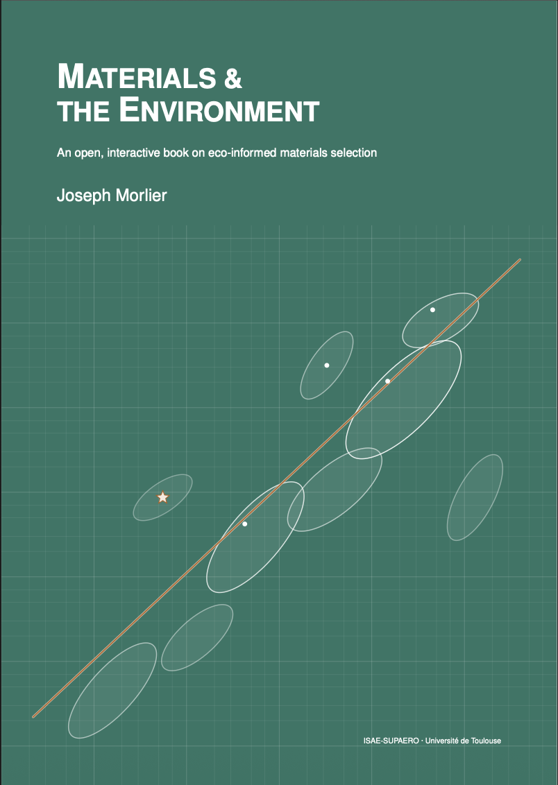
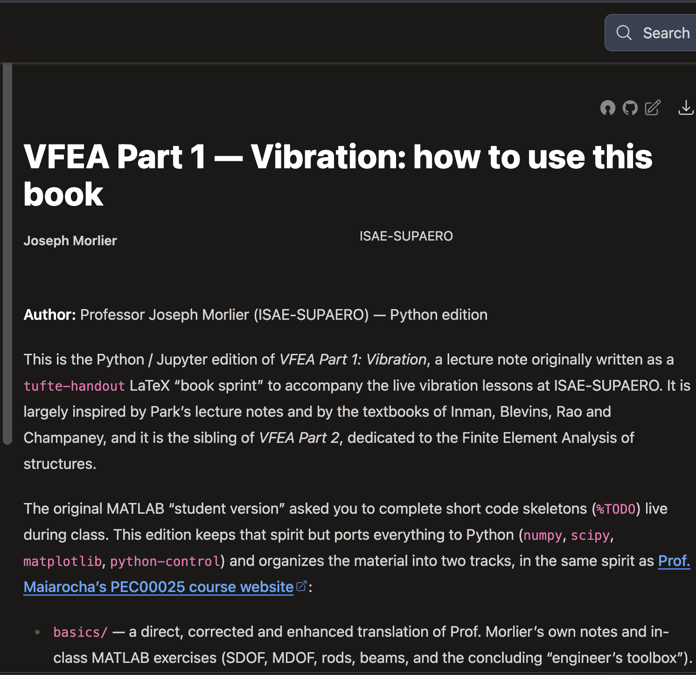

Open, interactive books and lecture notes.

  <article class="box box--img">
    

    

      
Interactive book

      <h3><a class="stretch" href="https://materialsandtheenvironment.github.io">Materials and the environment</a></h3>
      
An open, interactive book on eco-informed materials selection.

      
Read the book →

    

  </article>
  <article class="box box--img">
    

    

      
Interactive book

      <h3><a class="stretch" href="https://jomorlier.github.io/VFEA/">VFEA Part 1: Vibration</a></h3>
      
Vibration lessons in Python and Jupyter.

      
Read the book →

    

  </article>
  <article class="box box--todo">
    
Lecture notes

    <h3>To come</h3>
    
Lecture notes will be added here.

  </article>

