
Figures from talks and courses. Each thumbnail links to its source: slide decks are in
<a href="https://github.com/mid2SUPAERO/Outputs">mid2SUPAERO/Outputs</a>, course material in
<a href="https://github.com/jomorlier/mdocourse">mdocourse</a> and
<a href="https://jomorlier.github.io/VFEA/">VFEA</a>.

## Structural & topology optimization

  <a href="https://github.com/mid2SUPAERO/Outputs/blob/master/ESAFORM_JM.pdf">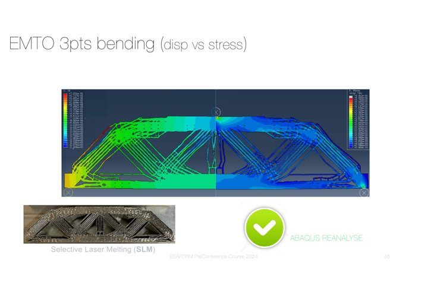3-point bending of an optimized truss <em>ESAFORM, slide 37</em></a>
  <a href="https://github.com/mid2SUPAERO/Outputs/blob/master/CSMA2024_JM.pdf">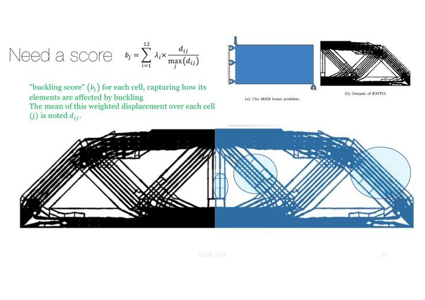Truss topologies compared with a score <em>CSMA 2024, slide 26</em></a>
  <a href="https://github.com/mid2SUPAERO/Outputs/blob/master/TOPGGP_light-compressed.pdf">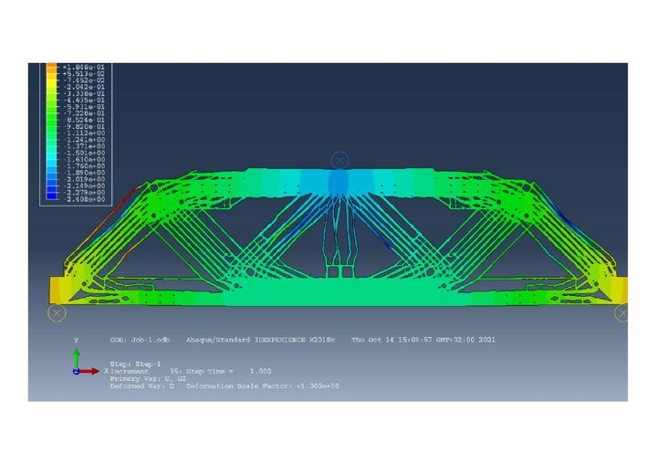Optimized truss, stress field <em>TOPGGP, slide 58</em></a>
  <a href="https://github.com/mid2SUPAERO/Outputs/blob/master/ESAFORM_JM.pdf">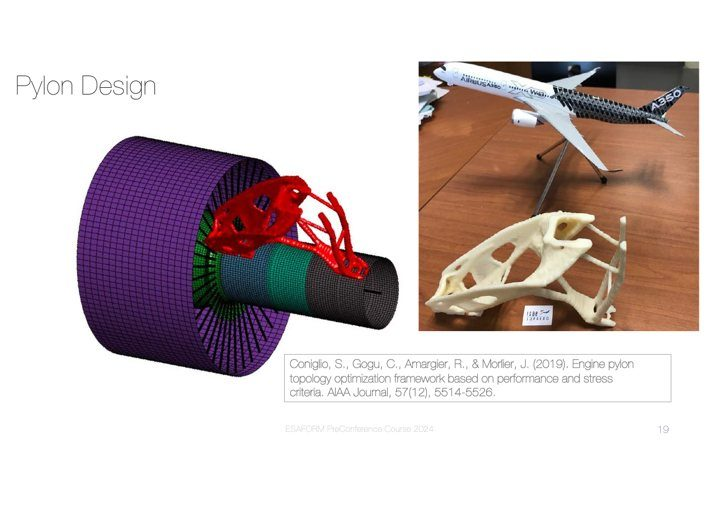Pylon design, from model to printed part <em>ESAFORM, slide 16</em></a>
  <a href="https://github.com/mid2SUPAERO/Outputs/blob/master/AMS2-compressed.pdf">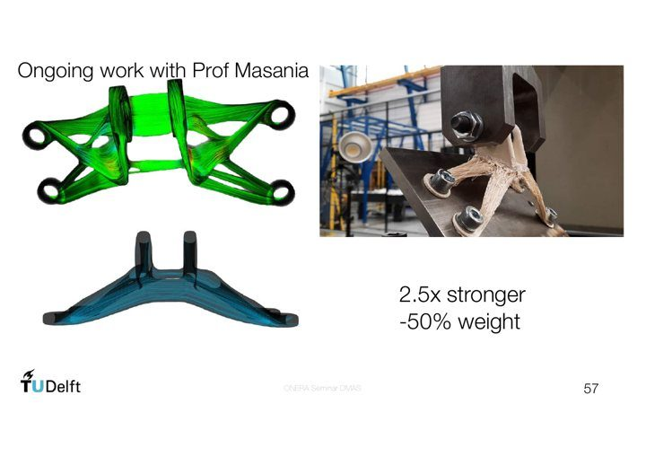Lighter, stronger bracket, with TU Delft <em>AMS2, slide 52</em></a>
  <a href="https://github.com/mid2SUPAERO/Outputs/blob/master/PEML_MORLIER-compressed.pdf">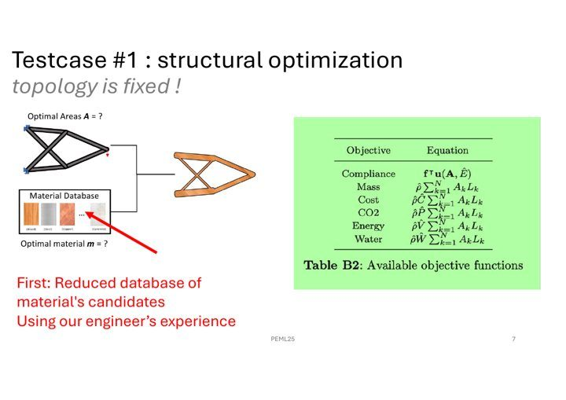Structural optimization test case <em>PEML, slide 6</em></a>

## Eco-design & materials

  <a href="https://github.com/mid2SUPAERO/Outputs/blob/master/AEC2020_duriez_compressed.pdf">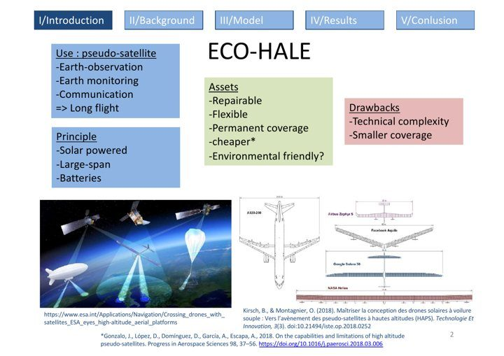ECO-HALE: eco-designing a high-altitude aircraft <em>AEC 2020, slide 2</em></a>
  <a href="https://github.com/mid2SUPAERO/Outputs/blob/master/TOPGGP_light-compressed.pdf">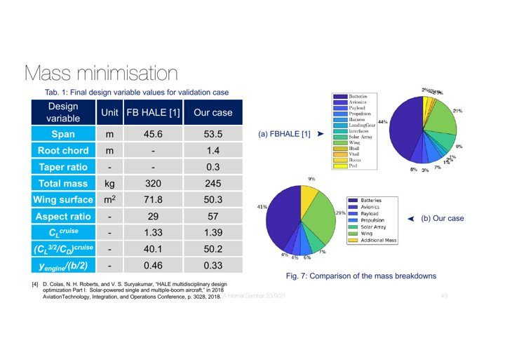Mass minimization and mass breakdown <em>TOPGGP, slide 46</em></a>
  <a href="https://github.com/mid2SUPAERO/Outputs/blob/master/ITB2light-compressed.pdf">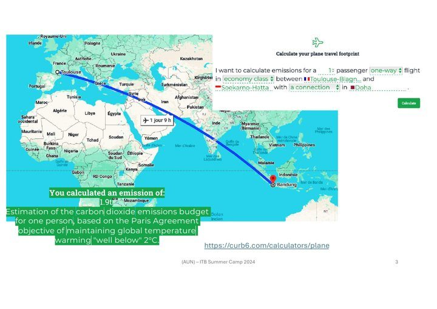Footprint of a long-haul flight <em>ITB, slide 3</em></a>
  <a href="https://github.com/mid2SUPAERO/Outputs/blob/master/ITB2light-compressed.pdf">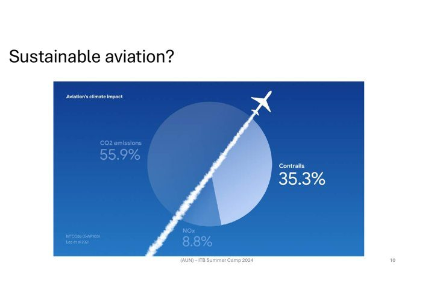Sustainable aviation? <em>ITB, slide 9</em></a>
  <a href="https://github.com/jomorlier/mdocourse">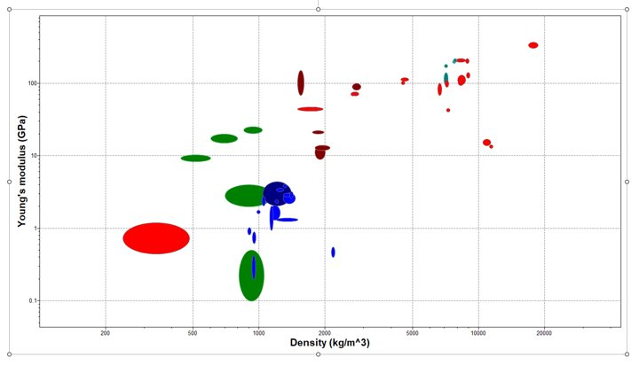Ashby chart: modulus vs. density <em>mdocourse</em></a>
  <a href="https://github.com/jomorlier/mdocourse">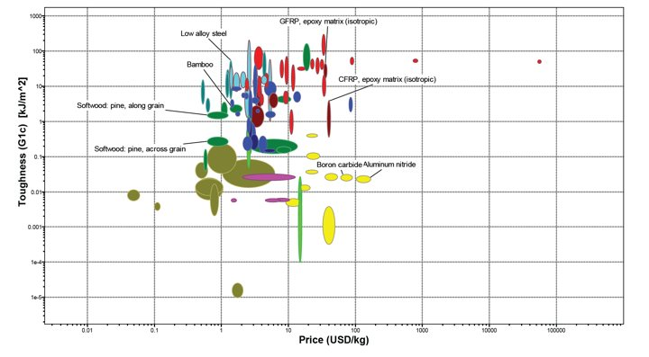Ashby chart: toughness vs. price <em>mdocourse</em></a>
  <a href="https://github.com/jomorlier/mdocourse">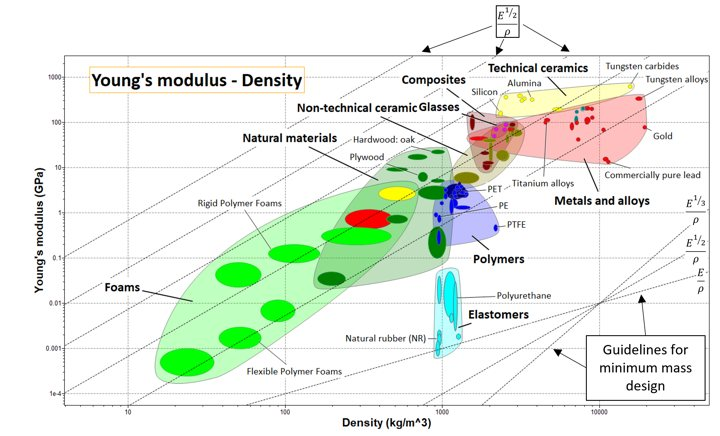Ranking lines for minimum-mass design <em>mdocourse</em></a>

## Surrogate modeling & AI for engineers

  <a href="https://github.com/mid2SUPAERO/Outputs/blob/master/CSMA_SEGO-compressed.pdf">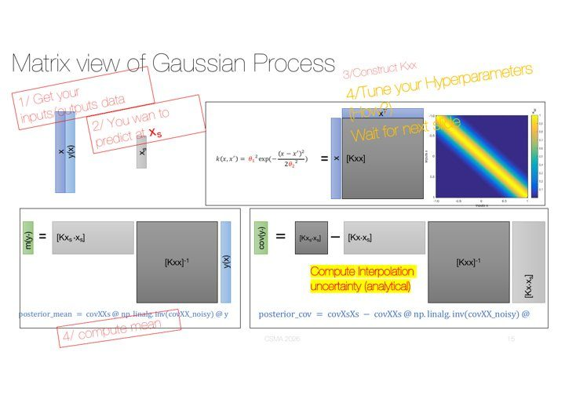Matrix view of a Gaussian process (kriging) <em>CSMA, slide 12</em></a>
  <a href="https://github.com/mid2SUPAERO/Outputs/blob/master/SMT_FONISEN-compressed.pdf">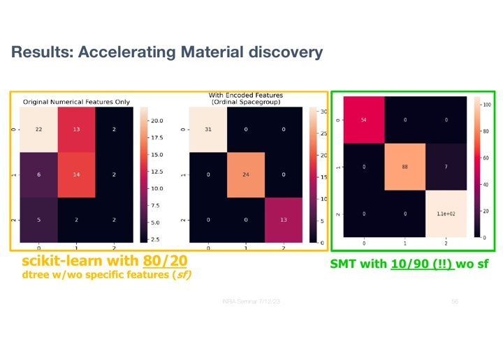SMT vs. scikit-learn for material discovery <em>FONISEN, slide 32</em></a>
  <a href="https://github.com/mid2SUPAERO/Outputs/blob/master/MDO-06-17_CEDAR.pdf">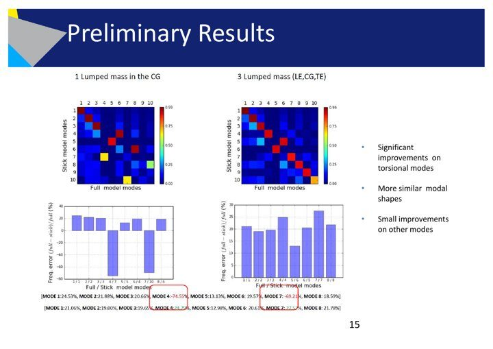Preliminary surrogate results <em>CEDAR, slide 15</em></a>
  <a href="/gp-bo/">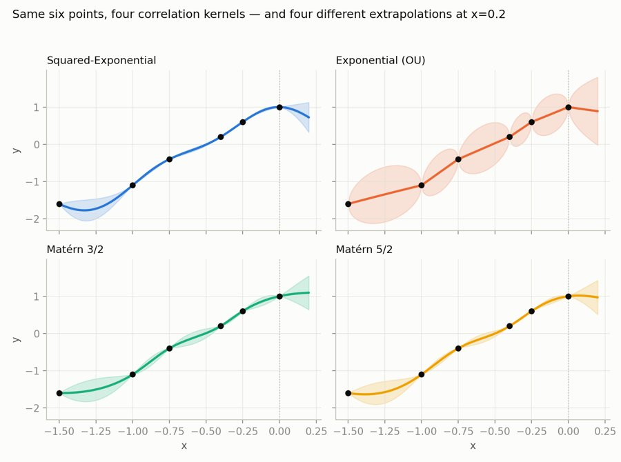Gaussian process kernels <em>interactive page</em></a>
  <a href="/surrogate/">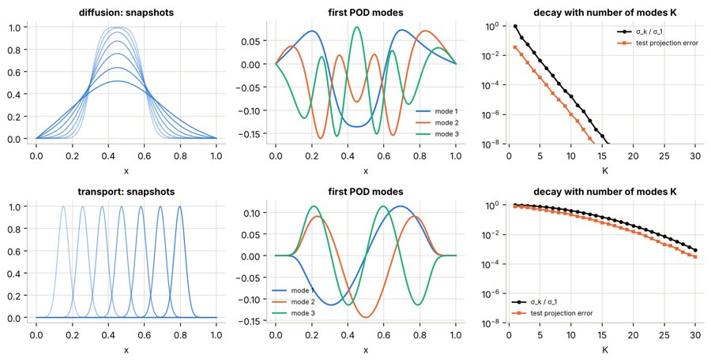POD modes <em>interactive page</em></a>
  <a href="/ashby-maps-renewed/">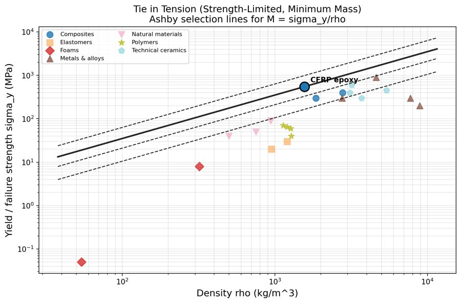Ashby maps, renewed <em>interactive page</em></a>

## Vibration & numerical methods (course figures)

  <a href="https://jomorlier.github.io/VFEA/">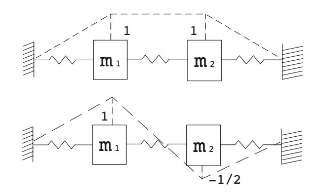Mode shapes of a two-mass system <em>VFEA</em></a>
  <a href="https://jomorlier.github.io/VFEA/">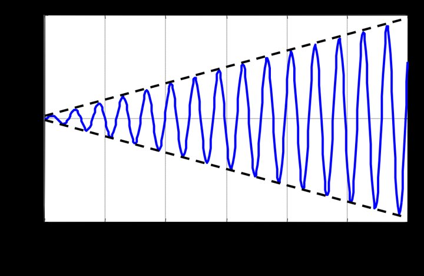Resonance: growing amplitude <em>VFEA</em></a>
  <a href="https://jomorlier.github.io/VFEA/">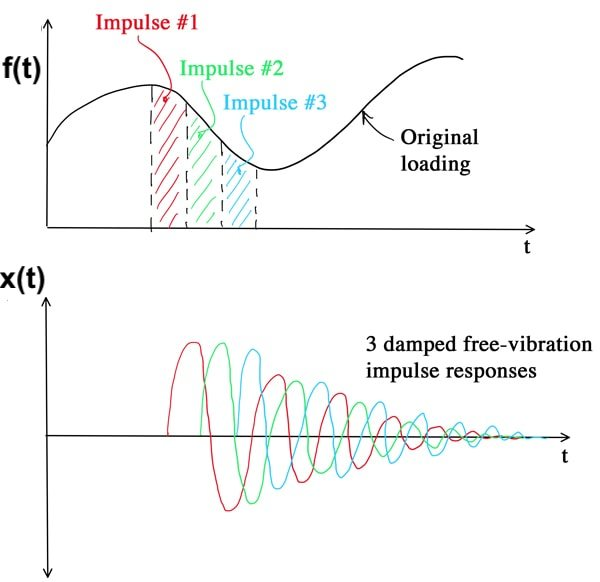Loading as a sum of impulse responses <em>VFEA</em></a>
  <a href="https://jomorlier.github.io/VFEA/">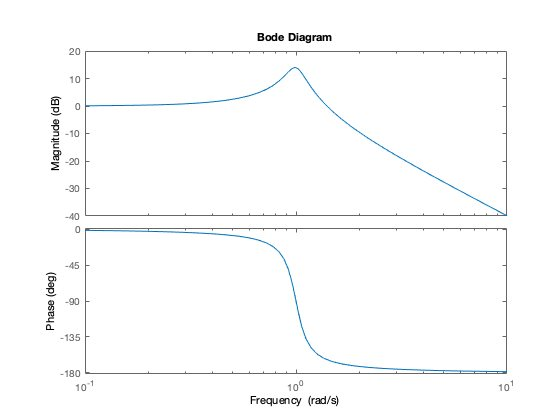Bode diagram <em>VFEA</em></a>
  <a href="https://github.com/jomorlier/mdocourse">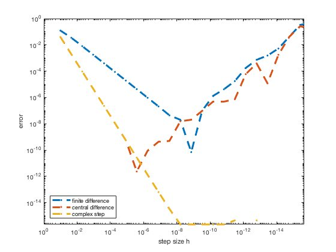Complex-step vs. finite-difference error <em>mdocourse</em></a>

