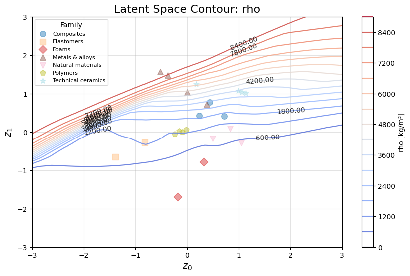
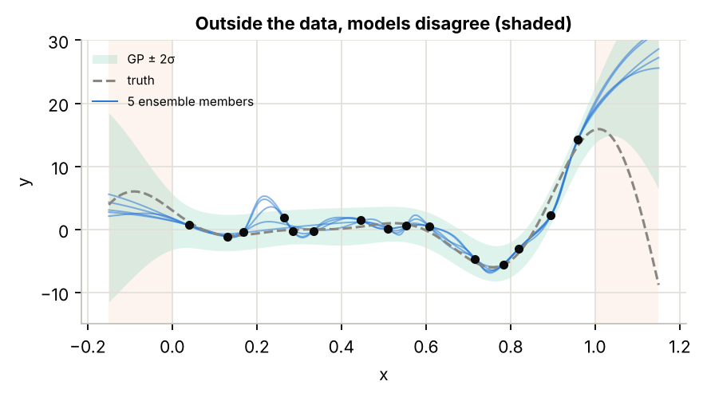
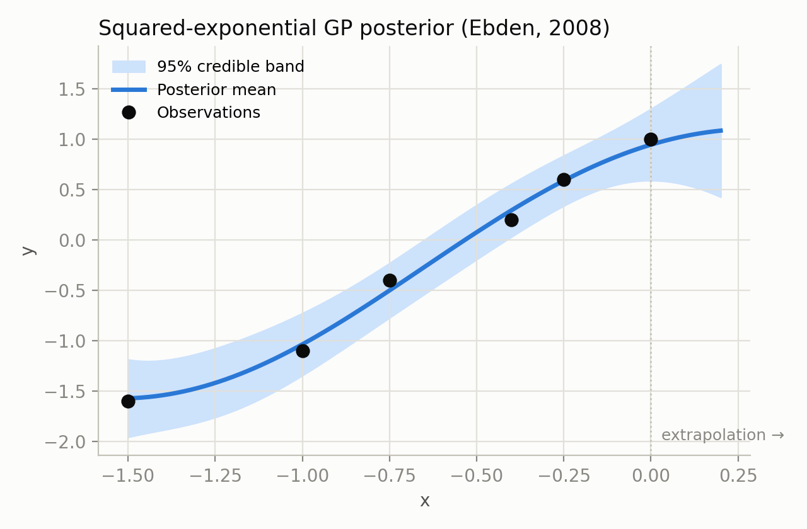
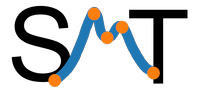
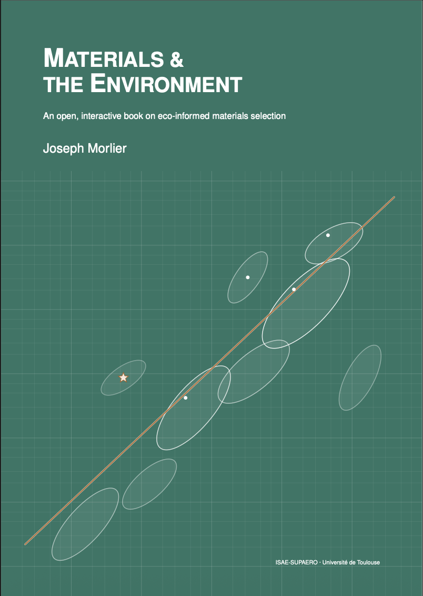
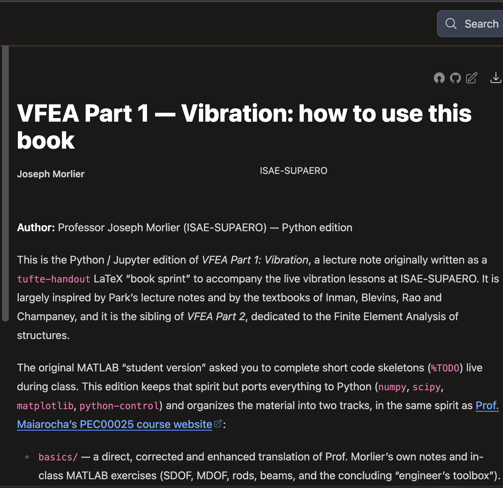
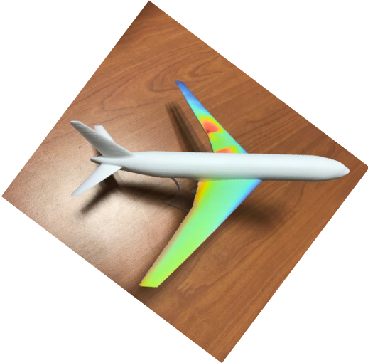

<section class="hero">
  

    
MID2 research group · ISAE-SUPAERO, Toulouse

    <h1>Design ultra efficient aerospace vehicles / aerostructures that weigh less, last longer and cost the planet less.</h1>
    
MDO, surrogate modeling and eco-design for aerospace systems — from topology-optimized parts to full aeroelastic wings — Reducing AI complexity and footprint to AI4Physics.

    

      <a class="btn primary" href="/research.html">Our research</a>
      <a class="btn" href="/team.html">Meet the team</a>
      <a class="btn" href="https://github.com/SMTorg/SMT">SMT toolbox ↗</a>
    

  

  

    
  

</section>

<strong>Joseph F.A. Morlier</strong> — Professor in Aerospace Engineering, ISAE-SUPAERO · 📥 joseph.morlier at isae-supaero.fr 
I lead <strong>MID2</strong> (Multidisciplinary optimization for aerospace Innovation: eco Design and Data), Université de Toulouse.

<h2 class="section">Research</h2>

  <a class="topic" href="/research.html#ai4physics"><strong>AI4Physics &amp; Gaussian processes</strong><em>Surrogates, kriging, multifidelity and mixed-variable models.</em></a>
  <a class="topic" href="/research.html#mdo"><strong>Multidisciplinary design optimization</strong><em>Coupled disciplines, aircraft, UAV and launcher design.</em></a>
  <a class="topic" href="/research.html#aeroelasticity"><strong>Aeroelasticity &amp; flexible wings</strong><em>Fluid–structure coupling for highly flexible wing design.</em></a>
  <a class="topic" href="/research.html#ecodesign"><strong>Eco-design &amp; life-cycle assessment</strong><em>Material selection and design under environmental impact.</em></a>
  <a class="topic" href="/research.html#digital-materials"><strong>Digital materials &amp; fabrication</strong><em>Voxel-based materials and additive manufacturing.</em></a>
  <a class="topic" href="/research.html#topology"><strong>Topology &amp; shape optimization</strong><em>Optimal layouts of structures, from trusses to 3D parts.</em></a>
  <a class="topic" href="/research.html#multiscale"><strong>Multiscale &amp; geometric projection</strong><em>Architectured materials and projection of primitives.</em></a>
  <a class="topic" href="/research.html#vibration"><strong>Vibration &amp; health monitoring</strong><em>Modal identification, signals and damage detection.</em></a>

  <article class="bigbox">
    

    

      
Interactive explainer

      <h3><a class="stretch" href="/research.html#ecodesign">Ashby's maps, renewed</a></h3>
      
Material selection charts revisited with latent spaces.

      <a class="alt" href="/ashby-maps-renewed/">Open the explainer →</a>
    

  </article>
  <article class="bigbox">
    

    

      
Interactive explainer

      <h3><a class="stretch" href="/research.html#ai4physics">Surrogate modeling</a></h3>
      
From design of experiments to POD, ensembles and conformal prediction.

      <a class="alt" href="/surrogate/">Open the explainer →</a>
    

  </article>
  
  <article class="bigbox">
    

    

      
Interactive explainer

      <h3><a class="stretch" href="/research.html#ai4physics">Gaussian processes &amp; Bayesian optimization</a></h3>
      
Kernels, posteriors and acquisition, step by step.

      <a class="alt" href="/gp-bo/">Open the explainer →</a>
    

  </article>
  <article class="bigbox">
    

    

      
Open-source software

      <h3><a class="stretch" href="/research.html#ai4physics">SMT — Surrogate Modeling Toolbox</a></h3>
      
Gaussian processes, mixed and hierarchical variables, multifidelity modeling.

      <a class="alt" href="/software.html">See all software →</a>
    

  </article>
  <article class="bigbox">
    

    

      
Interactive book

      <h3><a class="stretch" href="/research.html#ecodesign">Materials &amp; the environment</a></h3>
      
An open, interactive book on eco-informed materials selection.

      <a class="alt" href="https://materialsandtheenvironment.github.io">Read the book →</a>
    

  </article>
  <article class="bigbox">
    

    

      
Interactive book

      <h3><a class="stretch" href="/research.html#vibration">VFEA Part 1 — Vibration</a></h3>
      
How to use this book: vibration lessons in Python and Jupyter.

      <a class="alt" href="https://jomorlier.github.io/VFEA/">Read the book →</a>
    

  </article>
  <article class="bigbox">
    

    

      
Research

      <h3><a class="stretch" href="/research.html#aeroelasticity">Aeroelastic aircraft design</a></h3>
      
Load alleviation and highly flexible wings, with differentiable tools.

      <a class="alt" href="/software.html">See the tools →</a>
    

  </article>
  <article class="bigbox">
    

    

      
Overview

      <h3><a class="stretch" href="/research.html">Research at a glance</a></h3>
      
MDO, eco-design, topology optimization, digital fabrication and AI4E.

      <a class="alt" href="/team.html">Meet the team →</a>
    

  </article>

Also: <a href="/LearnwithAI.html">Learn with AI</a> <a href="/teaching.html">Teaching</a> <a href="/readings.html">Readings</a> <a href="/software.html">Software</a> <a href="/team.html">Team</a> <a href="/books.html">Books</a> <a href="/about.html">About</a>

<h2 class="section">Latest posts</h2>

  
  <a class="post" href="{{ post.url | relative_url }}">
    <time datetime="{{ post.date | date_to_xmlschema }}">{{ post.date | date: "%b %-d, %Y" }}</time>
    <h3>{{ post.title }}</h3>
  </a>
  

<small>All posts via <a href="{{ '/feed.xml' | relative_url }}">RSS</a>.</small>

<h2 class="section">Publications &amp; links</h2>

  <a href="https://scholar.google.fr/citations?user=wi1HSroAAAAJ&hl=fr">Google Scholar</a>
  <a href="https://openalex.org/authors/A5005187572">OpenAlex</a>
  <a href="https://www.webofscience.com/wos/author/rid/Y-1209-2019">Web of Science</a>
  <a href="https://orcid.org/0000-0002-1511-2086">ORCID</a>
  <a href="https://github.com/mid2SUPAERO/Outputs">MID2 outputs</a>
  <a href="https://personnel.isae-supaero.fr/joseph-morlier/?lang=fr">ISAE-SUPAERO page</a>
  <a href="https://www.linkedin.com/in/joseph-morlier-890176168/">LinkedIn</a>

