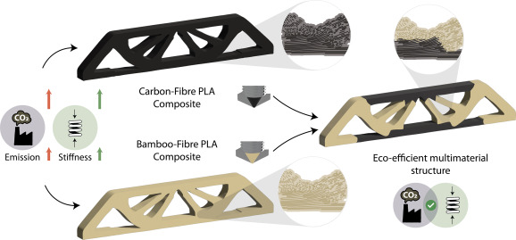
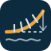
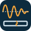

<section class="hero">
  

    
MID2 research group · ISAE-SUPAERO, Toulouse

    <h1>Design ultra efficient aerospace vehicles / aerostructures that weigh less, last longer and cost the planet less.</h1>
    

      We develop structural optimization, surrogate modeling and eco-design methods for
      aerospace systems — from topology-optimized parts to full aeroelastic wings.
    

    

      <a class="btn btn--primary" href="/research.html">Our research</a>
      <a class="btn" href="/team.html">Meet the team</a>
      <a class="btn btn--ghost" href="https://github.com/SMTorg/SMT">SMT toolbox ↗</a>
    

  

  

    
  

</section>

<section class="intro">
  
  

    <h2>Joseph F.A. Morlier</h2>
    
Professor in Aerospace Engineering · 📥 joseph.morlier at isae-supaero.fr

    

      I lead <strong>MID2</strong> — <em>Multidisciplinary optimization for aerospace Innovation:
      eco Design and Data</em>. This site collects our research, open-source software,
      interactive books and teaching material.
    

    

      Université de Toulouse, ISAE-SUPAERO · Fédération ENAC ISAE-SUPAERO ONERA, Toulouse, France
    

  

</section>

<h2 class="section-title">Research</h2>

  <a class="topic" href="/gp-bo/"><strong>AI4Physics &amp; Gaussian processes</strong><em>Surrogates, kriging, multifidelity and mixed-variable models.</em></a>
  <a class="topic" href="/software.html"><strong>Multidisciplinary design optimization</strong><em>Coupled disciplines, aircraft, UAV and launcher design.</em></a>
  <a class="topic" href="/research.html"><strong>Aeroelasticity &amp; flexible wings</strong><em>Fluid–structure coupling for highly flexible wing design.</em></a>
  <a class="topic" href="/research.html"><strong>Digital materials &amp; fabrication</strong><em>Voxel-based materials and additive manufacturing.</em></a>
  <a class="topic" href="/ashby-maps-renewed/"><strong>Eco-design &amp; life-cycle assessment</strong><em>Material selection and design under environmental impact.</em></a>
  <a class="topic" href="/software.html"><strong>Topology &amp; shape optimization</strong><em>Optimal layouts of structures, from trusses to 3D parts.</em></a>
  <a class="topic" href="/research.html"><strong>Multiscale &amp; geometric projection</strong><em>Architectured materials and projection of primitives.</em></a>
  <a class="topic" href="/teaching.html"><strong>Vibration &amp; health monitoring</strong><em>Modal identification, signals and damage detection.</em></a>

<h2 class="section-title">Explore</h2>

  <a class="tile" href="/team.html">👥<strong>Team</strong>PhD students, visitors, alumni</a>
  <a class="tile" href="/software.html">💻<strong>Open-source software</strong>SMT, SMT-optim, TOSM, TASOPT…</a>
  <a class="tile" href="/books.html">📘<strong>Interactive books</strong>Materials &amp; the environment, VFEA</a>
  <a class="tile" href="/teaching.html">🎓<strong>Teaching</strong>MDO, FEA, AI for structural mechanics</a>
  <a class="tile" href="/readings.html">📖<strong>Readings</strong>Articles I wish I had written</a>
  <a class="tile" href="/LearnwithAI.html">✨<strong>Learn with AI</strong>Interactive explorers for mechanics</a>

<h2 class="section-title">Interactive explainers</h2>

  <a href="/ashby-maps-renewed/">Ashby maps, renewed</a>
  <a href="/ashby-maps/">Ashby maps</a>
  <a href="/surrogate/">Surrogate modeling</a>
  <a href="/gp-bo/">Gaussian processes &amp; Bayesian optimization</a>
  <a href="/gallery.html">Figure gallery</a>

<h2 class="section-title">Latest posts</h2>

  
  <a class="post" href="{{ post.url | relative_url }}">
    <time datetime="{{ post.date | date_to_xmlschema }}">{{ post.date | date: "%b %-d, %Y" }}</time>
    <h3>{{ post.title }}</h3>
    
{{ post.content | strip_html | strip_newlines | truncate: 140 }}

  </a>
  

Subscribe <a href="{{ '/feed.xml' | relative_url }}">via RSS</a>.

<h2 class="section-title">Publications &amp; links</h2>

  <a href="https://scholar.google.fr/citations?user=wi1HSroAAAAJ&hl=fr">Google Scholar</a>
  <a href="https://openalex.org/authors/A5005187572">OpenAlex</a>
  <a href="https://www.webofscience.com/wos/author/rid/Y-1209-2019">Web of Science</a>
  <a href="https://orcid.org/0000-0002-1511-2086">ORCID</a>
  <a href="https://github.com/mid2SUPAERO/Outputs">MID2 outputs (GitHub)</a>
  <a href="https://personnel.isae-supaero.fr/joseph-morlier/?lang=fr">ISAE-SUPAERO page</a>
  <a href="https://www.linkedin.com/in/joseph-morlier-890176168/">LinkedIn</a>

  Vulgarisation:
  <a href="https://www.linkedin.com/pulse/possible-build-aircraft-wing-lego-joseph-morlier/">Can we build an aircraft wing in LEGO®?</a> ·
  <a href="https://www.linkedin.com/pulse/optimization-mdo-connecting-people-joseph-morlier/">MDO: optimization for connecting people?</a> 
  Networks: AIAA · ISSMO · SIAM · A3F · AFM · GDR MASCOT-NUM · GDR IAMAT

