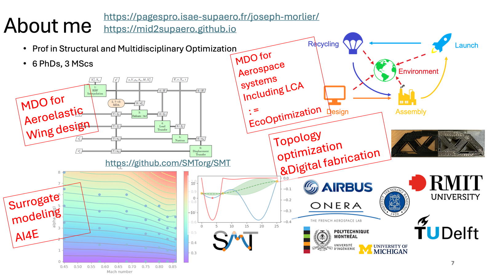

<nav class="chapter-nav" aria-label="Research chapters">
  <a href="#ai4physics">AI4Physics &amp; GP</a>
  <a href="#mdo">MDO</a>
  <a href="#aeroelasticity">Aeroelasticity</a>
  <a href="#ecodesign">Ecodesign &amp; LCA</a>
  <a href="#digital-materials">Digital materials</a>
  <a href="#topology">Topology</a>
  <a href="#multiscale">Multiscale</a>
  <a href="#vibration">Vibration &amp; SHM</a>
</nav>

<h2 id="ai4physics" class="chapter">AI4Physics and Gaussian Process</h2>

  <article class="box">
    
Active project

    <h3>SMT</h3>
    
Common research with ONERA, IRD, Polytechnique Montréal, University of Michigan, UCSD, ITB, etc.

    
<a href="https://arxiv.org/abs/2305.13998">Preprint</a><a href="https://doi.org/10.1016/j.advengsoft.2024.103571">Paper</a><a href="https://github.com/SMTorg/smt">Code</a><a href="https://smt.readthedocs.io/en/latest/">Documentation</a>

  </article>
  <article class="box">
    
Active project

    <h3>MARIO</h3>
    
Common research with TSAAELab / Airbus.

    
PreprintPaper<a href="https://github.com/giovannicatalani/MARIO">Code</a>Documentation

  </article>
  <article class="box">
    
In progress

    <h3>Splinecloud</h3>
    
<a href="https://splinecloud.com/">Website</a>

  </article>
  <article class="box">
    
In progress

    <h3>Frugal GP</h3>
  </article>

<h2 id="mdo" class="chapter">Multidisciplinary Design Optimization</h2>

  <article class="box">
    
In progress

    <h3>CasADi Sellar</h3>
    
Code and paper.

    
PaperCode

  </article>
  <article class="box">
    
Active project

    <h3>EcoHale</h3>
    
PaperCode

  </article>

<h2 id="aeroelasticity" class="chapter">Aeroelasticity and flexible wing</h2>

  <article class="box">
    
Active project

    <h3>Aircraft Maneuver Load Alleviation (MLA)</h3>
    
<a href="https://hal.science/hal-05670373v1">Preprint</a><a href="https://arc.aiaa.org/doi/abs/10.2514/1.C038643">Paper</a><a href="https://github.com/mid2SUPAERO/Analytical-LAF">Code</a>

  </article>
  <article class="box">
    
Active project

    <h3>GEBTaero-jax</h3>
    
<a href="https://github.com/mid2SUPAERO/gebtaero-jax">Code</a>

  </article>

<h2 id="ecodesign" class="chapter">Ecodesign and LCA</h2>

  <article class="box">
    
Book

    <h3>Materials and the environment</h3>
    
<a href="https://materialsandtheenvironment.github.io">Read online</a>

  </article>
  <article class="box">
    
In progress

    <h3>Material-based Aircraft Design</h3>
    
PaperCode

  </article>
  <article class="box">
    
In progress

    <h3>Material-based Launcher Design</h3>
    
PaperCode

  </article>

<h2 id="digital-materials" class="chapter">Digital materials and fabrication</h2>

  <article class="box">
    
Active project

    <h3>SOMP_Ansys</h3>
    
<a href="https://github.com/mid2SUPAERO/SOMP_Ansys">Code</a>

  </article>
  <article class="box">
    
Active project

    <h3>MMEcoTopOpt</h3>
    
<a href="https://github.com/gj-asai/MMEcoTopOpt">Code</a>

  </article>

<h2 id="topology" class="chapter">Topology and shape optimization</h2>

  <article class="box">
    
In progress

    <h3>IGA sensitivities</h3>
    
Code and paper.

    
PaperCode

  </article>
  <article class="box">
    
Active project

    <h3>TTO</h3>
    
<a href="https://github.com/mid2SUPAERO/TTO">Code</a>

  </article>

<h2 id="multiscale" class="chapter">Multiscale and geometric projection</h2>

  <article class="box">
    
Active project

    <h3>EMTO</h3>
    
Efficient Multiscale Topology Optimization.

    
<a href="https://github.com/mid2SUPAERO/EMTO">Code</a>

  </article>
  <article class="box">
    
Active project

    <h3>TOPGGP</h3>
    
Topology Optimization using Generalized Geometric Projection.

    
<a href="https://topggp.github.io/blog/">Blog</a>

  </article>

<h2 id="vibration" class="chapter">Vibration and health monitoring</h2>

No active project. Teaching material: [VFEA Part 1: Vibration](https://jomorlier.github.io/VFEA/).

---

## Publications

The most up to date and complete list is on Google Scholar.

- [Google Scholar profile](https://scholar.google.fr/citations?user=wi1HSroAAAAJ&hl=fr)
- [Open Science ISAE-SUPAERO publication feed](https://pagespro.isae-supaero.fr/joseph-morlier/joseph-morlier/flux-publications-open-science-isae-supaero.html)
- [ORCID record](https://orcid.org/0000-0002-1511-2086)
- [Web of Science](https://www.webofscience.com/wos/author/rid/Y-1209-2019)

## Conferences organisation

- [EASN 2026](https://easnconference.eu/2026/programme/sessions)
- [MDO 2025](https://www.isae-supaero.fr/en/isae-supaero/our-newsroom/news/from-modeling-to-decarbonation-mdo-as-a-driver-of-transformation-at-the-4th-european-workshop/)
- MDO PhD Day 2019 and 2023 (ISAE + ONERA)
- [Surday 2021](https://sites.google.com/view/surday2021/)
- [OpenMDAO 2017](https://www.onera.fr/fr/agenda/euro-openmdao-2017)

## Vulgarisation

- [TOPOPT — Is it possible to build an aircraft wing in LEGO®?](https://www.linkedin.com/pulse/possible-build-aircraft-wing-lego-joseph-morlier/)
- [MDO — Optimization for connecting people?](https://www.linkedin.com/pulse/optimization-mdo-connecting-people-joseph-morlier/)

## Latest outputs and presentations

The MID2 group keeps its latest slides, posters and code releases in a dedicated GitHub repository: [github.com/mid2SUPAERO/Outputs](https://github.com/mid2SUPAERO/Outputs).
