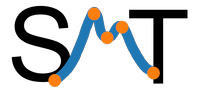

The following open-source tools are associated with my research activities and collaborations at ISAE-SUPAERO and within the MID2 research group. They cover surrogate modeling, Bayesian optimization, structural and topology optimization, and aerostructural analysis.

  <article class="box box--img box--feature">
    

    

      
Surrogate modeling

      <h3><a class="stretch" href="https://github.com/SMTorg/smt">SMT — The Surrogate Modeling Toolbox</a></h3>
      
A Python toolbox providing surrogate modeling methods (including Gaussian processes and radial basis functions), sampling techniques, and benchmark problems. It is designed for engineering and scientific applications, with particular attention to derivatives, mixed and hierarchical variables, and multifidelity modeling.

      
github.com ↗

    

  </article>
  <article class="box">
    
Derived from SMT

    <h3><a class="stretch" href="https://github.com/SMTorg/smt-optim">SMT-optim</a></h3>
    
A Python toolbox for constrained and multifidelity Bayesian optimization of expensive black-box functions. It integrates with SMT surrogate models and supports continuous, integer, and categorical design variables.

    
github.com ↗

  </article>
  <article class="box">
    
Derived from SMT

    <h3><a class="stretch" href="https://github.com/relf/egobox">EGObox</a></h3>
    
Rust toolbox for Efficient Global Optimization method (arguably the most well-known bayesian optimization algorithm) which adresses the gradient-free optimization of expensive objective functions.

    
github.com ↗

  </article>
  <article class="box">
    
Derived from SMT

    <h3><a class="stretch" href="https://github.com/jbussemaker/SBArchOpt">SBArchOpt</a></h3>
    
SBArchOpt (es-bee-ARK-opt) provides a set of classes and interfaces for applying Surrogate-Based Optimization (SBO) for system architecture optimization problems:

    
github.com ↗

  </article>
  <article class="box">
    
Neural fields

    <h3><a class="stretch" href="https://gitlab.isae-supaero.fr/gi.catalani/aero-nepf/-/blob/main/INR/">Aero-Nepf</a></h3>
    
Aero-Nepf leverages Neural Fields to model pressure fields for rapid aerodynamic simulations. The repository includes code to reproduce some of the experiments from our paper, namely on the 2D Transonic Airfoil. Features include handling of unstructured domains, robustness to discretization, and generalization to unseen geometries.

    
gitlab.isae-supaero.fr ↗

  </article>
  <article class="box">
    
Neural fields

    <h3><a class="stretch" href="https://github.com/giovannicatalani/MARIO">MARIO — Multiscale Aerodynamic Resolution Invariant Operator</a></h3>
    
MARIO is a conditional Neural Field architecture designed for surrogate modeling of large PDEs and it is specialized for aerodynamic applications, although the framework is absolutely general. It can handle paramteric and non parametric geometric variability. In the latter case, a Neural Field encoder is used to learn a latent code on the Signed Distance Function fields (as in the Airfrans and VKI-BLADE test cases).

    
github.com ↗

  </article>
  <article class="box">
    
Neural fields

    <h3><a class="stretch" href="https://github.com/giovannicatalani/enf2enf">enf2enf — Equivariant Neural Field Networks</a></h3>
    
Code accompanying research on neural-field surrogates for steady-state PDEs on general geometries. The approach encodes geometric information to predict physical fields across varying domains.

    
github.com ↗

  </article>
  <article class="box">
    
Topology optimization

    <h3><a class="stretch" href="https://topggp.github.io/blog/">TOPGGP — Topology Optimization using Generalized Geometric Projection</a></h3>
    
A framework for feature-based structural topology optimization, unifying geometric projection, moving morphable components, and moving-node approaches. Implementations and developments are available for MATLAB, Python, and Julia through the project website.

    
topggp.github.io ↗

  </article>
  <article class="box">
    
Topology optimization

    <h3><a class="stretch" href="https://github.com/mid2SUPAERO/EMTO">EMTO — Efficient Multiscale Topology Optimization</a></h3>
    
MATLAB code to reproduce the results of the Efficient Multiscale Topology Optimization strategy, combining macro-scale optimization with optimized microstructures.

    
github.com ↗

  </article>
  <article class="box">
    
Aerostructures

    <h3><a class="stretch" href="https://github.com/jomorlier/gebtaero-jax">GEBTaero-jax</a></h3>
    
gebtaero-jax v0.1 — differentiable nonlinear aeroelasticity for high-aspect-ratio wings, in pure Python/JAX It's a re-implementation of GEBTAero (geometrically exact beam + strip aerodynamics, ISAE-Supaero) built around one idea: write the residual R(ẋ, x, p, t) = 0 and let JAX do the calculus. Tangent stiffness, mass matrices, derivatives of nonlinear equilibria and the gradient of the flutter speed with respect to any design parameter all come from automatic differentiation. No Fortran, no hand-derived Jacobians.

    
github.com ↗

  </article>
  <article class="box">
    
Aerostructures

    <h3><a class="stretch" href="https://github.com/mid2SUPAERO/aerostructures">Aerostructures</a></h3>
    
A Python package based on the OpenMDAO framework for aerostructural analysis and optimization, including workflows using NASTRAN-95 and PANAIR.

    
github.com ↗

  </article>

<small>This page highlights projects for which a public repository or project documentation could be identified. Please consult each repository for its current license, installation instructions, contributors, and citation recommendations.</small>

